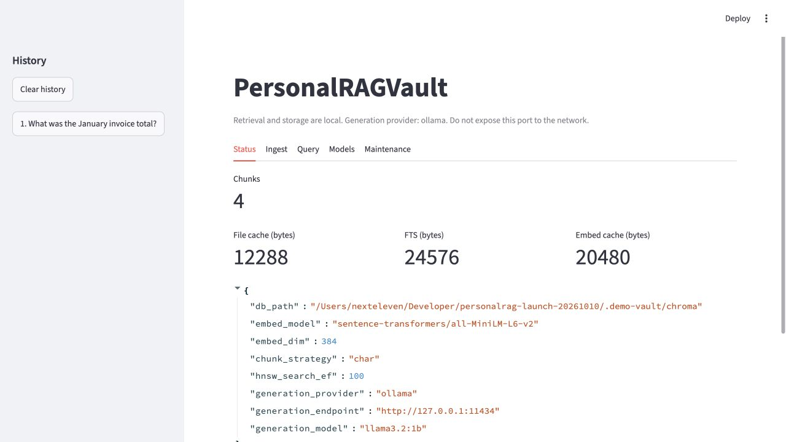
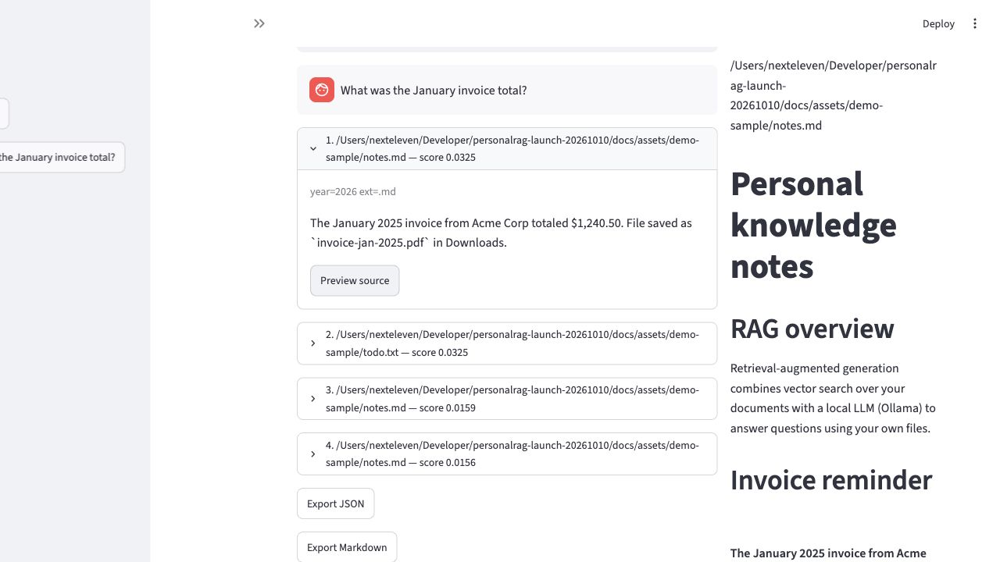

# PersonalRAGVault

[](https://github.com/seanebones-lang/personal-RAG/actions/workflows/ci.yml)
[](LICENSE)

**Find the answer in your own files.** PersonalRAGVault searches PDFs, notes, code,
and saved exports on your machine. Inspect the matching text and its source, or
optionally ask a local Ollama model to compose an answer from the retrieved context.

Free under the MIT license. Built by [NextEleven](https://www.nexteleven.dev).
This is a local Python application with a CLI, an optional browser interface, and
an HTTP API for integrations.

## Start with the sample, not your documents

Requires Git and **Python 3.10–3.12**. The setup script selects a supported installed
Python; you can choose one explicitly with `PRV_PYTHON=python3.11`.

```bash
git clone --branch v1.5.1 --depth 1 https://github.com/seanebones-lang/personal-RAG.git
cd personal-RAG
./scripts/setup.sh --ui
./scripts/try-demo.sh
```

The demo indexes only the repository's synthetic sample in `.demo-vault/`, then
searches for the January invoice total. Expect source text containing **$1,240.50**.
It uses real local embeddings and retrieval, calls no generation provider, and
requires no API key or Ollama installation. The first run downloads the embedding
model from Hugging Face and can take several minutes. Python dependencies and model
files need disk space; the application can search locally after those downloads.

For the browser interface with that same sample index:

```bash
source .venv/bin/activate
PRV_DB_PATH="$PWD/.demo-vault/chroma" PRV_LLM_PROVIDER=ollama personalragvault ui
```

Open `http://127.0.0.1:8501`, select **Query**, check **Retrieval only**, and ask
“What was the January invoice total?” See [the sample walkthrough](docs/TRY_DEMO.md).

**Version:** 1.5.1. Use the [matching GitHub release](https://github.com/seanebones-lang/personal-RAG/releases/tag/v1.5.1)
for a wheel, source archive, checksums, and installation notes. Run
`personalragvault --version` to identify your installation. There is no PyPI
publication promised by these instructions. The old `v5.0` tag contains package
1.4.1; it is a historical label, not a newer distribution. See
[release and verification guidance](docs/RELEASING.md).
Independent usefulness and retrieval quality on your own files still need evaluation.

## Add your own folder

```bash
source .venv/bin/activate
personalragvault ingest /path/to/your/sample-folder --recursive --dry-run
personalragvault ingest /path/to/your/sample-folder --recursive
personalragvault query "Where are my notes about this project?" --no-llm --hybrid
```

Choose a small folder first. The default personal index is separate from the demo,
at `~/.personalragvault/chroma`. Set `PRV_DB_PATH` to choose another index.
Use `--allow-outside-home` only when deliberately indexing a folder outside your home.
See [installation](INSTALL.md), [configuration](docs/configuration.md), and
[large vaults](docs/large-vaults.md) before indexing a large collection.

## Optional generated answers

Install [Ollama](https://ollama.com/), then:

```bash
ollama pull llama3.2:1b
personalragvault query "What did we decide about this project?"
```

Local Ollama is the default generation provider. An external OpenAI-compatible
endpoint is an explicit configuration option: generated-answer requests send
retrieved context to that endpoint. `--no-llm` disables generation requests,
including model-based query expansion. Embedding and reranker models may download
on first use. Retrieval matches and generated citations need your review; neither
establishes that an answer is correct.

## Features

| Feature | Description |
|---------|-------------|
| Ingest | PDF, TXT, MD, JSON, DOCX, **.ics calendar**, **browser bookmarks** (Chrome, Raindrop, Pinboard), **WhatsApp chats**, **Notion exports**, **images (optional OCR)**, and common code/text formats |
| Chunking | Multiple strategies (semantic, prose, Markdown/Python aware) |
| Dedup | Stable chunk IDs; re-ingest updates instead of duplicating |
| Query | Hybrid + multi-query + rerank + parent expansion + **streaming answers** |
| Citations | Model cites sources; CLI automatically extracts and displays them |
| Diagnostics | `doctor` + `config edit` for reliable local operation |
| Watch | Debounced folder watching for automatic re-ingest |
| Manage | `status`, `purge`, `reindex`, `compact`, evaluation tools |

## Choose a retrieval workflow

- **Vector search:** semantic matches using CPU embeddings.
- **Hybrid search:** vector results combined with SQLite FTS5 keyword search, with
  a BM25 fallback.
- **Presets:** `fast`, `balanced`, and `quality` combine optional reranking,
  heuristic multi-query retrieval, and parent context expansion.
- **Evaluation:** compare retrieval against your labeled cases with Hit@k, MRR,
  and NDCG@k. A sample result is not a general accuracy benchmark.
- **Integrations:** `personalragvault serve` exposes a local FastAPI interface;
  [API configuration](docs/configuration.md) covers its optional bearer token.

## Browser interface

Status, Ingest, Query, Models, and Maintenance tabs are available with `--ui` setup.
Keep the interface on localhost. Use sample documents for demonstrations and review
source previews before sharing screenshots.

| Status | Query |
|--------|-------|
|  |  |

## Documentation

- [Sample walkthrough](docs/TRY_DEMO.md) — first local search without an API key
- [Installation](INSTALL.md) and [getting started](docs/getting-started.md)
- [CLI reference](docs/cli-reference.md) and [configuration](docs/configuration.md)
- [Architecture](docs/architecture.md) and [evaluation](docs/evaluation.md)
- [FAQ](docs/faq.md), [large vaults](docs/large-vaults.md), and [documentation index](docs/README.md)
- [Changelog](CHANGELOG.md)

## Development and contribution

```bash
./scripts/setup.sh --dev --ui
source .venv/bin/activate
ruff check src tests
pytest -m "not integration"
```

See [development](docs/development.md), [CONTRIBUTING.md](CONTRIBUTING.md), and
[CODE_OF_CONDUCT.md](CODE_OF_CONDUCT.md). Report defects and confusing integration
steps in [GitHub issues](https://github.com/seanebones-lang/personal-RAG/issues).
For vulnerability reports, follow [SECURITY.md](SECURITY.md).

## License

[MIT](LICENSE). Copyright (c) 2026 Sean McDonnell.
